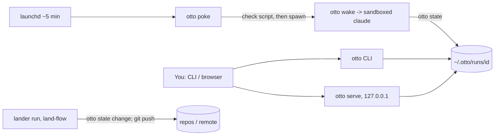

# otto — architecture

Last checked against: `ced9a1a` on 2026-11-09

## Purpose and boundaries

otto is a Rust CLI that keeps a Claude Code skill, runbook or goal working for days as a **run**:
state on disk, short-lived **wakes** (one non-interactive `claude` each), **gates** that wait for
the person's answer, an inbox, and **changes** (code handed back) that a system run, the
**lander**, puts on the base branch once the person approves them. The reasoning is in
`DESIGN.md` (§1–4); the vocabulary is in `docs/concepts.md`.

**Out of scope:** doing the work itself (otto contributes durability, not doing); a daemon that
owns a run; deciding *whether* code lands (the person does, per version); any login or
multi-user access to the web UI.

## Components and data flow



| Component | Where | Does |
|---|---|---|
| CLI entry | `src/main.rs`, `src/cli.rs` | clap surface; person commands in `src/human.rs`, their data in `src/core.rs` |
| State writer | `src/state/mod.rs`, `src/state/ops.rs`, `src/state/commands.rs` | the only writer of run state: lock, atomic rewrite, journal |
| Wake | `src/wake/mod.rs`, `src/wake/launcher.rs`, `src/wake/contract.rs` | one wake, then validates the stopping-point contract |
| Poke | `src/poke.rs`, `src/launchd.rs` | spawns due wakes, reaps, kills past deadline; runs check scripts |
| Sandbox | `src/sandbox.rs` | Seatbelt wrapper and generated profile a wake can't take off |
| Changes | `src/changes.rs`, `src/state/change.rs` | versions, approval bound to a version, landing records |
| Authorization and repo locks | `src/state/authorize.rs`, `src/state/locks.rs` | gates that authorize outward actions; one owner per repo |
| System agents | `src/agents.rs`, `workflows/land-flow.md` | the lander (only run that pushes) and babysitter |
| Web UI | `src/server/mod.rs`, `src/server/handlers.rs` | review/approve page; Host and Origin checks |
| Paths and config | `src/paths.rs`, `src/config.rs` | `$OTTO_HOME` layout, run ids, `config.json` |
| Wake instructions | `harness/wake.md`, `skills/` | what a wake is told |

## Where state lives

Layout in `docs/concepts.md` ("Where everything lives"); model in `DESIGN.md` §6.

| State | Where | Survives a crash? | Backed up? |
|---|---|---|---|
| Run record | ~/.otto/runs/ID/run.json | yes: temp file + fsync + rename + dir fsync (`src/state/mod.rs`) | no |
| Journal | runs/ID/journal.jsonl | append-only, fsynced (Unverified for every writer) | no |
| Gates, notes, outputs, changes | runs/ID/gates/, outputs/, changes/ | written through `otto state` | no |
| Repo locks | ~/.otto/runs/.locks/ | yes: flock-guarded files | no |
| Machine config | ~/.otto/config.json | atomic, concurrent edits kept | no |

No schema migrations: old records are read forward (e.g. a change from before evidence still
reads). `$OTTO_HOME` overrides ~/.otto.

## Trust boundaries

| Actor | Gets in by | Can | Can't |
|---|---|---|---|
| You | terminal (`otto …`), web page on 127.0.0.1 | answer gates, approve a change version, edit config | — |
| A wake | spawned by poke; sandboxed `claude` with a state token on a descriptor | write its own run via `otto state`, work in granted repos, submit changes | write other runs, config, git hooks, the person's ~/.claude, credentials; widen its sandbox |
| The lander | a system run named in `config.json` | land approved versions, push, open PRs | decide whether something lands; land a version not approved |
| Check scripts | run by poke before a wake | read, report change/no change | use `otto state` (documented in `docs/guides/check-scripts.md`) |
| The network | `otto serve` binds 127.0.0.1 only, no login | requests whose Host is 127.0.0.1/localhost and same Origin | DNS-rebinding or cross-origin writes |

Secrets: the wake's state token arrives on a file descriptor, not argv/env
(`tests/sandbox.rs`); credentials read as nothing inside the sandbox. Sandboxing guide:
`docs/guides/sandboxing.md`.

## Invariants

| # | Invariant | Enforced by |
|---|---|---|
| I1 | Approving binds to the version the person saw; a stale version is refused | `src/changes.rs`: `approving_a_version_that_is_no_longer_the_latest_is_refused`, `approving_needs_a_lander_and_binds_to_the_version` |
| I2 | Approving several is all-or-nothing | `tests/approve_many.rs`: `a_stale_version_anywhere_in_the_list_approves_nothing` |
| I3 | The web page approves only the version it showed | `src/server/mod.rs`: `approving_from_the_page_needs_the_version_it_showed` |
| I4 | Only the lander records a landing, and it lands what was approved | `src/changes.rs`: `only_the_lander_lands_and_it_lands_what_was_approved` |
| I5 | An outward push needs an answered gate for the same head | `src/state/authorize.rs`: `check_authorized_fails_on_head_mismatch_or_missing` |
| I6 | A change's new commit needs `--evidence` or `--no-evidence <reason>` | `tests/change_evidence.rs`: `a_new_commit_with_neither_flag_is_refused_with_nothing_written` |
| I7 | One repo lock has exactly one winner | `src/state/locks.rs`: `concurrent_locks_on_one_repo_have_exactly_one_winner` |
| I8 | Run ids and config edits are race-safe | `src/paths.rs`: `concurrent_claims_leave_last_id_at_the_highest`; `src/config.rs`: `concurrent_edits_keep_every_change` |
| I9 | State writes are atomic; readers never see a partial write | `src/state/mod.rs`: `concurrent_reads_never_see_a_partial_write` |
| I10 | The wake lock is taken before state is read | `src/wake/mod.rs`: `the_wake_lock_is_taken_before_the_state_is_read` |
| I11 | A wake can't write state past its own run | `tests/sandbox.rs`: `otto_state_past_its_own_run_can_not_be_written` |
| I12 | A run edited past its sandbox record starts nothing | `tests/sandbox.rs`: `a_run_edited_past_its_record_starts_nothing_until_it_agrees` |
| I13 | Git hooks and config can't be written from a wake | `tests/sandbox.rs`: `git_hooks_and_config_can_not_be_written` |
| I14 | The web server refuses other websites (Host/Origin) | `src/server/mod.rs`: `other_websites_are_refused` |
| I15 | Only the lander's wake actually runs `git push` | **unenforced:** I4/I5 cover otto's records, not a wake running git directly; candidate for a test |
| I16 | Check scripts have no `otto state` access | **unenforced:** documented, no test found |

## Decisions

Full history in `DESIGN.md` §20.

- 2026-10-31 · live tests approve the version they looked at · approval binds to a version (4edbcf6)
- 2026-10-31 · take the wake lock before reading state · no stale read-modify-write (9621636)
- 2026-11-07 · `--evidence` / `--no-evidence` named where a change is submitted · every version carries proof or a reason (4363745)
- 2026-11-07 · Seatbelt wrapper plus generated profile (sandbox 1.2) · a wake can't take its sandbox off (d7f5083)
- 2026-11-08 · terminals and clipboard closed to wakes · report 44 (ced9a1a)

## Family

Not a Bun-family app; it runs them. See [FAMILY.md](../../../architect/FAMILY.md) (~/workspace/architect/FAMILY.md).

## How to verify a change

Rung 1 on the verifiability ladder (~/workspace/architect/VISION.md): `cargo test` runs the
unit and integration tests in one command, and a builder can run them against the base commit
in a worktree. `test/live.sh` drives real `claude` wakes, but there's no one-command evidence
script and the review page shows evidence only when a change attaches it.

```bash
OTTO_HOME=$(mktemp -d) cargo test
test/live.sh   # live tests: real claude, slow, costs tokens
```

## Unverified

- Whether `tests/sandbox.rs` really ran its checks here or skipped them: it skips when a
  sandbox can't nest (`can_nest`), and a skipped test still reports as passing.
- That every journal writer fsyncs; only `src/state/mod.rs` and `src/state/links.rs` were seen.
- That the lander's push is the only push in practice (see I15); `live_*` tests weren't run.
- Rung 1 (the red/green workflow being documented in the repo) wasn't checked beyond `cargo test`.
