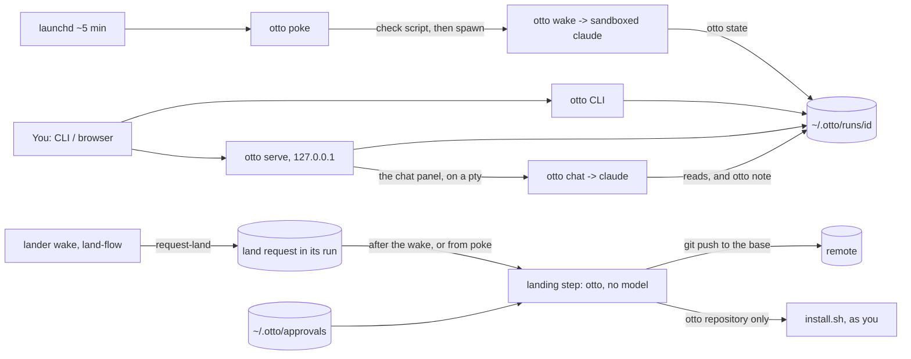

# otto — architecture

Last checked against: `9339419` on 2026-11-19

## Purpose and boundaries

otto is a Rust CLI that keeps a Claude Code skill, runbook or goal working for days as a **run**:
state on disk, short-lived **wakes** (one non-interactive `claude` each), **gates** that wait for
the person's answer, an inbox, and **changes** (code handed back). Once the person approves a
change, a system run, the **lander**, asks for it to be landed and otto itself pushes it to the
base branch, outside any wake. Reasoning: `DESIGN.md` (§1–4) and `workflows/land-flow.md`;
vocabulary: `docs/concepts.md`.

**Out of scope:** doing the work itself (otto contributes durability, not doing); a daemon that
owns a run; deciding *whether* code lands (the person does, per version); any login or
multi-user access to the web UI.

## Components and data flow



| Component | Where | Does |
|---|---|---|
| CLI entry | `src/main.rs`, `src/cli.rs` | clap surface; person commands in `src/human.rs`, their data in `src/core.rs` |
| State writer | `src/state/mod.rs`, `src/state/ops.rs`, `src/state/commands.rs` | the only writer of run state: lock, atomic rewrite, journal |
| Wake | `src/wake/mod.rs`, `src/wake/launcher.rs`, `src/wake/contract.rs` | one wake, then validates the stopping-point contract |
| Poke | `src/poke.rs`, `src/launchd.rs` | spawns due wakes, reaps, kills past deadline; runs check scripts; backstop for the landing step |
| Sandbox | `src/sandbox.rs`, `src/sandbox_switch.rs`, `src/sandbox_report.rs` | Seatbelt wrapper and generated profile a wake can't take off, also used for a run's check script; `otto sandbox observe/enforce/off` set a run's sandbox record and `report` reads what a sandbox refused |
| Changes | `src/changes.rs`, `src/state/change.rs` | versions, approving, what the lander may claim and say |
| Approvals | `src/approvals.rs` | the person's approval, one record per change, kept outside the run; the authority for what lands, where and how |
| Landing step | `src/landing.rs`, `src/landing/install.rs` | otto, with no model: judges the lander's request against the approval on record, then pushes and records the landing; after a landing on the otto repository only, clones the landed commit and runs its `install.sh` |
| Authorization and repo locks | `src/state/authorize.rs`, `src/state/locks.rs` | gates that authorize outward actions; one owner per repo |
| System agents | `src/agents.rs`, `workflows/land-flow.md` | the lander (asks for landings; opens, updates and merges pull requests) and babysitter |
| Web UI | `src/server/mod.rs`, `src/server/handlers.rs` | review/approve page; Host and Origin checks |
| Chat panel | `src/server/chats.rs`, `src/server/pty.rs`, `web/vendor/` | one live `otto chat` per run on a pseudo-terminal, over a websocket to xterm.js in the page |
| Paths and config | `src/paths.rs`, `src/config.rs` | `$OTTO_HOME` layout, run ids, `config.json` |
| Wake instructions | `harness/wake.md`, `skills/` | what a wake is told |

## Where state lives

Layout in `docs/concepts.md` ("Where everything lives"); model in `DESIGN.md` §6.

| State | Where | Survives a crash? | Backed up? |
|---|---|---|---|
| Run record | ~/.otto/runs/ID/run.json | yes: temp file + fsync + rename + dir fsync (`src/state/mod.rs`) | no |
| Journal | runs/ID/journal.jsonl | append-only, fsynced (Unverified for every writer) | no |
| Gates, notes, outputs, changes | runs/ID/gates/, outputs/, changes/ | written through `otto state` | no |
| Repo locks | ~/.otto/runs/.locks/ | yes: flock-guarded files | no |
| Machine config | ~/.otto/config.json | atomic, concurrent edits kept | no |
| Approvals | ~/.otto/approvals/RUN/N.json | written before the run's index says approved (`src/changes.rs`) | no |
| Landing results, scratch repositories, install logs | ~/.otto/landings/ | the result is written before the push; an unrecorded push is recorded, not repeated (I19) | no |
| Sandbox records, caches, Claude folders | ~/.otto/sandbox/runs/ID.json, sandbox/caches/ID, sandbox/claude/ID | Unverified | no |

No schema migrations: old records are read forward. `$OTTO_HOME` overrides ~/.otto. A sandboxed
wake can't write `approvals/`, `landings/` or `sandbox/` beyond its own caches and Claude folder.

## Trust boundaries

| Actor | Gets in by | Can | Can't |
|---|---|---|---|
| You | terminal (`otto …`), web page on 127.0.0.1 | answer gates, approve a change version, edit config, turn a run's sandbox on or off (`otto sandbox observe/enforce/off`) | — |
| A wake | spawned by poke; `claude` with a state token on a descriptor, sandboxed when its launcher goes through the wrapper | write its own run via `otto state`, work in granted repos, submit changes | when sandboxed: write other runs, config, approvals, landings, sandbox records, git hooks, the person's ~/.claude, credentials; nor, sandboxed or not, run `otto sandbox observe/enforce/off` (refused from any wake or chat) |
| The lander | a system run named in `config.json` | ask for an approved version to be landed (`request-land`); open, update and merge pull requests; clean up | push to a base branch through otto, or record a direct landing: `landed` is refused; get pull-request changes when it is sandboxed (they need `gh`) |
| The landing step | otto itself, after the lander's wake and from poke; not sandboxed | push the approved commit, or a clean rebase of it, to the base the approval names; start `install.sh` after a landing on the otto repository | follow the request's or the index's repository, base or remote; run the repository's hooks, ssh command or credential helper |
| `install.sh` | started by the landing step from a clone of the landed commit | run as you, unsandboxed, detached in its own session (`start` in `src/landing/install.rs` spawns `/bin/sh`, not `sandbox-exec`) | run after a merged pull request, or for a repository that isn't the linked otto checkout |
| Check scripts | run by poke before a wake, under the run's sandbox profile when the run has a sandbox record; as you when it has none | read, report change/no change, write inside their own run | run at all when the run disagrees with its sandbox record; use `otto state` (documented only, I16) |
| A web chat | started by `otto serve` on a pseudo-terminal when the page opens the chat panel: `otto chat`, as you | what a terminal `otto chat` can: read, and leave a note once you approve it | write run state (`OTTO_CHAT`), Edit or Write; outlive the server, which hangs every chat up before it exits |
| The network | `otto serve` binds 127.0.0.1 only, no login | requests whose Host is 127.0.0.1/localhost and same Origin; a websocket only with this page's Origin | DNS-rebinding, cross-origin writes, or another site's websocket into a chat |

Secrets: the wake's state token arrives on a file descriptor, not argv/env (`tests/sandbox.rs`);
credentials read as nothing inside the sandbox (`docs/guides/sandboxing.md`). A sandboxed wake
can't renew `claude`'s sign-in, so otto first checks it will last the wake (`src/wake/mod.rs`).

## Invariants

† marks a test that returns early, asserting nothing, when it can't enter a sandbox
(`can_nest()` in `tests/sandbox.rs` is false, as inside a sandboxed wake); it still passes.

| # | Invariant | Enforced by |
|---|---|---|
| I1 | Approving binds to the version the person saw; a stale version is refused | `src/changes.rs`: `approving_a_version_that_is_no_longer_the_latest_is_refused`, `approving_needs_a_lander_and_binds_to_the_version` |
| I2 | Approving several is all-or-nothing | `tests/approve_many.rs`: `a_stale_version_anywhere_in_the_list_approves_nothing` |
| I3 | The web page approves only the version it showed | `src/server/mod.rs`: `approving_from_the_page_needs_the_version_it_showed` |
| I4 | Only the lander claims a change, and only what was approved passes its check; the lander's own `landed` is refused for a direct change and the landing step records it | `src/changes.rs`: `only_the_lander_lands_and_it_lands_what_was_approved` |
| I5 | An outward push needs an answered gate for the same head | `src/state/authorize.rs`: `check_authorized_fails_on_head_mismatch_or_missing` |
| I6 | A change's new commit needs `--evidence` or `--no-evidence <reason>` | `tests/change_evidence.rs`: `a_new_commit_with_neither_flag_is_refused_with_nothing_written` |
| I7 | One repo lock has exactly one winner | `src/state/locks.rs`: `concurrent_locks_on_one_repo_have_exactly_one_winner` |
| I8 | Run ids and config edits are race-safe | `src/paths.rs`: `concurrent_claims_leave_last_id_at_the_highest`; `src/config.rs`: `concurrent_edits_keep_every_change` |
| I9 | State writes are atomic; readers never see a partial write | `src/state/mod.rs`: `concurrent_reads_never_see_a_partial_write` |
| I10 | The wake lock is taken before state is read | `src/wake/mod.rs`: `the_wake_lock_is_taken_before_the_state_is_read` |
| I11 | A wake can't write state past its own run | `tests/sandbox.rs`: `otto_state_past_its_own_run_can_not_be_written` † |
| I12 | A run edited past its sandbox record starts nothing | `tests/sandbox.rs`: `a_run_edited_past_its_record_starts_nothing_until_it_agrees` |
| I13 | Git hooks and config can't be written from a wake | `tests/sandbox.rs`: `git_hooks_and_config_can_not_be_written` † |
| I14 | The web server refuses other websites (Host/Origin) | `src/server/mod.rs`: `other_websites_are_refused` |
| I15 | otto's landing step, not the lander, pushes to a base branch; a sandboxed lander can ask and can't push | `tests/landing.rs`: `an_approved_change_is_pushed_by_the_step_after_the_wake_and_only_once`; `tests/sandbox.rs`: `a_sandboxed_lander_can_ask_for_a_landing_and_not_do_one` †. **Unenforced** for a wake that isn't sandboxed |
| I16 | A check script can't write outside its run; it has no `otto state` access | first half, only for a run with a sandbox record: `tests/sandbox.rs`: `a_check_can_not_write_outside_its_run` †. **Unenforced** otherwise: `otto state` is documented, no test found, and a check can write its own run's files |
| I17 | Only the approved commit, or a clean rebase with the same patch-id, is pushed, to the repository and base on the approval record, never forced | `tests/landing.rs`: `an_unapproved_change_and_another_patch_are_refused_with_why`, `a_base_and_repository_forged_in_the_index_are_not_followed`, `a_moved_base_is_not_forced_and_the_clean_rebase_lands` |
| I18 | Nothing a wake planted in the repository runs during, or redirects, the push | `tests/landing.rs`: `nothing_a_wake_planted_in_the_repository_runs_or_redirects_the_push`, `the_repositorys_ssh_command_is_not_run_for_an_ssh_remote`, `the_repositorys_credential_helper_is_not_run_for_an_http_remote` |
| I19 | A push happens once | `tests/landing.rs`: `an_approved_change_is_pushed_by_the_step_after_the_wake_and_only_once`, `a_push_that_was_never_recorded_is_recorded_and_not_pushed_again`, `a_parent_killed_after_the_request_leaves_it_for_poke_to_land_once` |
| I20 | A sandboxed wake can't write an approval | `tests/sandbox.rs`: `no_record_opens_the_persons_approvals` †, `a_wake_can_not_approve_its_own_change` †. **Unenforced** for a wake that isn't sandboxed |
| I21 | `otto sandbox observe/enforce/off` are the person's alone (`report`, which only reads, isn't refused) | `tests/sandbox_commands.rs`: `none_of_them_runs_from_a_wake_or_a_chat`; `tests/sandbox.rs`: `the_sandbox_commands_can_not_be_run_from_inside` † |
| I23 | A chat's websocket opens only from this page | `src/server/mod.rs`: `a_websocket_opens_only_from_this_page`; `tests/web_chat.rs`: `a_chat_in_the_page_is_otto_chat_on_a_terminal_and_ends_in_the_journal` |
| I22 | Only a landing on the otto repository installs | `tests/landing.rs`: `a_landing_on_another_repository_installs_nothing_and_wakes_the_lander_to_clean_up`, `a_repository_that_only_looks_like_ottos_installs_nothing` |

## Decisions

Full history in `DESIGN.md` §20.

- 2026-10-31 · live tests approve the version they looked at · approval binds to a version (4edbcf6)
- 2026-10-31 · take the wake lock before reading state · no stale read-modify-write (9621636)
- 2026-11-07 · `--evidence` / `--no-evidence` named where a change is submitted · every version carries proof or a reason (4363745)
- 2026-11-07 · Seatbelt wrapper plus generated profile (sandbox 1.2) · a wake can't take its sandbox off (d7f5083)
- 2026-11-08 · terminals and clipboard closed to wakes · report 44 (ced9a1a)
- 2026-11-28 · the web page's chat is a terminal: `otto chat` on a pty, over a websocket · keeps the subscription meter and the person's approvals (plans/web-chat.md)
- by 2026-11-19 · otto pushes, not the lander; approval is a record outside the run · a wake's word proves nothing (`src/landing.rs`, `src/approvals.rs`; commits not traced)

## Family

Not a Bun-family app; it runs them. See [FAMILY.md](../../../architect/FAMILY.md) (~/workspace/architect/FAMILY.md).

## How to verify a change

Rung 1 on the verifiability ladder (~/workspace/architect/VISION.md): `cargo test` runs the unit
and integration tests, and a builder can run them against the base commit in a worktree. There
is no one-command evidence script; the review page shows evidence only when a change attaches it.

```bash
OTTO_HOME=$(mktemp -d) cargo test
test/live.sh   # live tests: real claude, slow, costs tokens
```

## Unverified

- Whether the tests marked † assert on a given machine. Outside a sandbox on 2026-11-19 they did.
- That a wake which isn't sandboxed is stopped from approving or pushing. Read at `9339419`, it
  isn't: `approve` (`src/changes.rs`) has no check for a wake, only the sandbox closes
  `approvals/`, and nothing stops such a wake running `git push` itself (I15, I20).
- That a check script can't use `otto state` or edit its own run's files directly (I16).
- That a pull request the lander merges with `gh` is the approved version; what `install.sh`
  does, running as the person with no sandbox; crash safety of sandbox records; that every
  journal writer fsyncs; rung 1 beyond `cargo test`. `live_*` tests weren't run.
