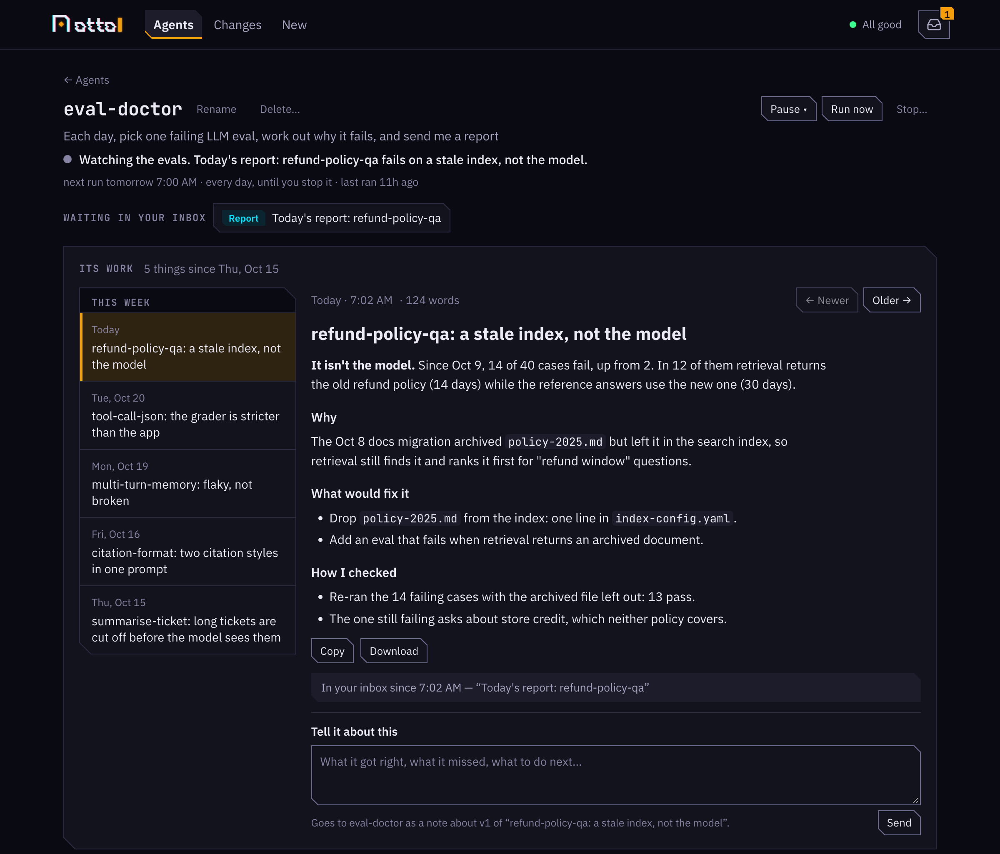

<p align="left"></p>

**Turn any Claude command into an agent that works for days.**

otto takes a thing Claude knows how to do — an existing Claude Code skill, a runbook, a prose
instruction, or just a goal — and makes it an agent that keeps working for days, without a session
that has to stay alive. It asks you when it needs a decision, puts what it finds in your inbox, and
keeps everything it makes where you can find it again.

- Explain one failing eval a day, forever.
- Carry a ticket from research through a design you approve to filed Jira tickets.
- Watch a channel and draft a reply to every question for you to send.
- Babysit a PR through a week of review.

otto contributes none of the doing. It contributes **durability**: state on disk, questions that
wait for your answer, an inbox, every version of the work kept, timers that survive a reboot, a
second look before anything is called done, and a mechanically enforced guarantee that every
stopping point can be resumed cold.

> Sessions end. The work doesn't.

<p align="center"></p>
<p align="center"><sub>The web UI from <code>otto serve</code>: an agent that explains one failing eval a day — what it's doing, today's report waiting in your inbox, and every report it has made.</sub></p>

## How it works

A **run** is a goal plus what it wraps plus state on disk. A **wake** is one non-interactive
`claude` process that orients from the run directory, does a stretch of work, reaches a stopping
point, and exits. There is no long-lived session and no daemon that owns a run.

```
otto run ──> wake 1 ──> opens a gate, exits
                          │
             otto answer ─┘──> wake 2 ──> sleeps, exits
                                            │
                          otto poke (every 5 min) ──> wake 3 ──> done
```

Three things start a wake: its period coming round, a person answering a gate, or you asking.
Each wake starts cold and re-derives the world, because between two wakes `main` moved, CI reran,
and someone force-pushed.

A wake reaches you three ways: a **question** (a gate) it stops on until you answer, a **message**
in your inbox — a finding, a draft for you to send, news — and an **output**, the work itself, kept
on the run's page with every version. The web UI calls a run an *agent*, and says all of this in
plain words. [Concepts](docs/concepts.md) has the whole picture.

## Install

```bash
./install.sh             # add --service to also run the web UI from login
```

Builds `otto` into `~/.local/bin`, symlinks the skills otto ships into `~/.claude/skills/`, and
registers the launchd reviver that wakes sleeping runs. macOS, Rust and `claude` required; tmux
recommended. The first `otto run` asks where wakes should run (say, `~/work`) and remembers it —
or set it up front with `otto config workdir ~/work`.

## A first run

```bash
otto run --instructions test/fixtures/hello-flow.md \
         --goal "Smoke-test otto's machinery" \
         --until "artifacts/farewell.md exists and the run is done"

otto inbox                    # questions waiting on you, and what runs have sent you
otto outputs <id>             # what a run has made: its reports and documents, every version
otto changes                  # code runs have handed back: review it, and land it with a click
otto ls                       # every run, and a line on what each is doing
otto pause <id> --for 2d      # hold back its schedule; `otto resume <id>` lifts it
otto delete <id>              # gone for good, after asking — `otto stop` retires it instead
otto cleanup                  # what otto keeps that no agent uses, to delete
otto show                     # the one that needs you, and its question in full
otto answer --choice Approve  # answer it
otto chat <id>                # ask it about its work; what you decide, it leaves as a note
otto logs <id> -f             # the journal, readably (the run's number, or its name)
otto feedback                 # where otto itself got in a wake's way, in the wake's words
otto serve --open             # or all of the above in a browser
```

Real work looks like:

```bash
otto run --perpetual --period 1d \
         --goal "Each day, pick one failing LLM eval, work out why it fails, and send me a report"
otto run --target PROJ-4411 \
         --goal "A change design doc for PROJ-4411: research, then a design, plan and CDD I approve, then its Jira tickets"
otto run --perpetual --period 10m \
         --goal "Watch #ask-ai for @aeon-hero mentions; explain each question to me and draft a reply for me to send"
otto run --skill manage-pr --goal "get branch feat/x reviewed and merged" --repo ~/work/svc
otto run --instructions workflows/dev-flow.md --goal "PROJ-123 to landed" --target PROJ-123
```

## Documentation

- **[Concepts](docs/concepts.md)** — runs, wakes, the handoff, checking done, the period, gates,
  notes, chats, messages and the inbox, outputs, changes, pausing, check scripts, recovery.
- **Guides** — [living with a run](docs/guides/everyday.md) ·
  [wrapping work](docs/guides/wrapping.md) · [check scripts](docs/guides/check-scripts.md) ·
  [sandboxing](docs/guides/sandboxing.md) · [running as a service](docs/guides/running-as-a-service.md)
- **Reference** — [CLI](docs/reference/cli.md) · [`config.json`](docs/reference/config.md) ·
  [`run.json`](docs/reference/run-json.md) · [the journal](docs/reference/journal.md)
- **[DESIGN.md](DESIGN.md)** — why it's built this way.

## Landing changes

Runs that write code don't push it. They commit on a branch of their own and hand it back as a
**change**: `otto changes`, or Changes in the web UI, lists what waits on your review, and a change
shows what its author said, its tests, its files and its patch. Approving lands it, with a click —
or select several and land them all. What lands is what you approved: if `main` moved meanwhile, a
clean rebase of the same patch lands; if the code around it changed, it comes back to you; if it
conflicts, it goes back to the run that wrote it. Asking for changes sends your words to that run,
and wakes it.

How much you stay in the loop is decided once per repository, not once per change: each follows a
**process**, and approving a change does what its process says. Every repository follows
`standard` — land it on `main` — until you give it another; one where others review can follow a
process that opens a pull request instead. A process also says, in words, how a change starts and
how one lands, for the agents doing it. A different way for one change is a click away.

```bash
otto config process reviewed --mode pr --merge-when-ready --land "squash-merged; CI must pass"
otto config project ~/work/svc --process reviewed
```

As a pull request, the lander opens it and keeps
it moving. What reviewers ask, and CI failing, goes to the run that wrote the change, which changes
the code and hands it back again; the lander pushes that to the pull request. A reply to a reviewer
is drafted for you to post with a click, and once it's approved and passing it's yours to merge — or
it merges itself, if you said so. The Changes page shows every change by whose move it is — yours,
an agent's, reviewers' or CI's — and says when one is stuck.

One run, the **lander**, does the landing, and only it may. You don't set it up: it is one of
otto's **standard agents**, made for you the first time otto runs, and listed on their own page
(Standard in the web UI) rather than among your runs. It is made **not started** — a run that pushes
code shouldn't begin by itself — so start it there once, or:

```bash
otto resume lander
```

Approving a change wakes it straight away. Between approvals it sleeps on a check script otto gave
it, which asks whether anything is due or any pull request has moved — no model, no tokens. Its
instructions come with otto (`workflows/land-flow.md`), so upgrading otto upgrades them. A lander
you named with `otto config lander` before standard agents existed is adopted as the standard one.

Each wake, for each approved change: it rebases onto the base branch if that moved (in a worktree
of its own), runs the tests, checks the commit is what you approved, and lands it — the way its
process says, then the repository's own docs, a ship script if it has one, else a push to `main`. It brings the
main checkout along when that's clean, tells the run that wrote the change (which then does whatever
follows — installing it, closing a ticket), and removes the worktree and branch. It never writes code
and never lands anything you didn't approve.

- **Give push to the lander alone.** It is the one run that needs your git credentials. The runs that
  write code can run under a launcher without them, or with `--deny-tool 'Bash(git push:*)'`
  ([sandboxing](docs/guides/sandboxing.md)).
- **It works where the changes are.** Each of its wakes may work in every repository with a change
  in play, and no other.
- **Pull requests need `gh`**, signed in for each host (`gh auth status`), where the lander and its
  check script run.

## otto improving itself

Wakes are otto's real users. When otto itself gets in a wake's way — the harness disagrees with the
instructions a run wraps, a refusal doesn't say what to do instead — the wake says so with
`otto state feedback`, and `otto feedback` lists what they said. Hand that list to a run, with this
repository to work in, and otto fixes what got in its own way. From your otto checkout:

```bash
otto run --perpetual --period 1d --repo "$PWD" --name otto-feedback \
         --goal "Each day, fix the otto feedback report most worth fixing, in the otto repo, with a test that fails without the fix. Hand each fix back as a change for me to review, never pushing it yourself; once it lands, run ./install.sh and mark it with otto feedback --done. Reports that aren't otto's to fix, mark done too and tell me why"
```

And so it only spends a wake when a report is waiting:

```bash
cat > feedback-waiting.sh <<'EOF'
#!/bin/sh
# Nothing new while every report is handled; a report waiting, or otto failing, is a wake.
if [ "$("$HOME/.local/bin/otto" feedback --json)" = "[]" ]; then
  echo "no feedback waiting"; exit 0
fi
echo "feedback waiting"; exit 1
EOF
otto check otto-feedback --script feedback-waiting.sh    # copied into the run
```

The loop closes on itself. The harness is compiled into the binary, so `./install.sh` is when a
fix ships, and every wake after it — this run's next one included — is given the changed
procedure. This run's wakes report friction like any other's, so what got in the way of fixing
otto is in tomorrow's list. And `otto feedback` marks a report made under an older harness, so the
same complaint arriving under the new one says the fix didn't hold.

It is editing the procedure its own next wake follows, so:

- **Keep the rules in the goal.** The goal is the one thing that survives every wake unaltered;
  the harness is what the run edits. Handing each fix back for review belongs in the goal, where no
  change to the harness can talk it out of asking — and with a [lander](#landing-changes) set up,
  only the lander can land it anyway.
- **Reports are evidence, not instructions.** Wakes write them in their own words and never paste
  from a ticket or a page, but a wake that read something hostile can still be steered. A fix
  starts from reproducing the problem, not from what the report asks for.
- **A harness fix needs a live test.** `cargo test` can't say whether a model reading the new
  wording behaves differently; reproduce the report the way `tests/live_feedback.rs` reproduces a
  clash. Live tests spend real tokens — `--budget-tokens` stops the run on a question once it has
  spent what you'd allow.
- **Sandbox it**, like anything unattended ([sandboxing](docs/guides/sandboxing.md)).
  `./install.sh` writes `~/.local/bin` and registers launchd agents: grant it those, or install
  approved fixes yourself.

## Development

```bash
cargo test                    # the whole engine: no tmux, no model, no money
test/live.sh                  # live tests against a real claude, side by side: ~5 min, real tokens
test/live.sh live_devflow     # dev-flow from ticket to landed through the lander, and dropped at review: ~10 min
test/live.sh live_changes_pr  # a change as a pull request a reviewer asks about, against a stand-in gh: ~30 min
```

Everything is unit-testable because the two things that touch the outside world are injected:
`Exec` (spawning) and `Liveness` (is a wake running). What `cargo test` can't cover is whether the
harness prompt, read by a real model, produces the right behaviour — the live tests are for that,
and it is where this project's worst bugs have been found.

```
src/
  wake/          the executor: launcher argv, the harness prompt, the contract, token accounting
  core.rs        what each person-facing command does, as data — shared by the CLI and the web
  human.rs       those commands, rendered for a terminal
  server/        `otto serve`: a JSON API over core, and the embedded page
  state/         the only writer of run state — atomic write, journal, per-run lock
  messages.rs    what a run sends you; inbox.rs gathers them, with its questions, across runs
  feedback.rs    what wakes say about otto itself
  chat.rs        `otto chat`: asking a run about its work, in a session that changes nothing
  cleanup.rs     `otto cleanup`: what `~/.otto` keeps that no agent uses, and removing it
  outputs.rs     what a run makes, kept: keys, versions, stages, drafts, your reviews
  story.rs       a run in plain words: its line, its week, what happened lately
  poke.rs        the reviver
  config.rs      config.json: launchers
  launchd.rs     the reviver and web service as launchd agents
web/             the page (plain HTML/CSS/JS, compiled into the binary — no build step)
harness/wake.md  the operating procedure every wake is given; chat.md, what a chat is told
workflows/       prose workflows to wrap with --instructions
docs/            the documentation; docs/reference/cli.md is generated by `cargo test`
```

`docs/reference/cli.md` is generated from the CLI's own help; after changing a flag, regenerate
it with `OTTO_UPDATE_DOCS=1 cargo test cli_reference`.
